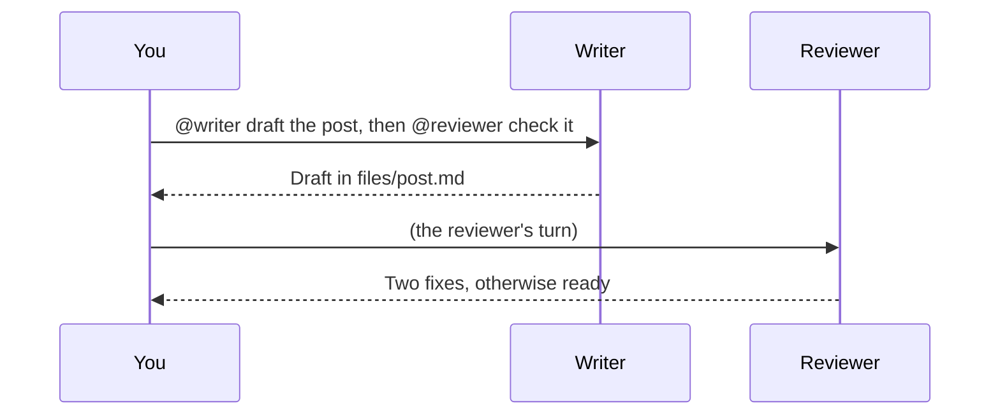

# Agent groups

A **group** puts 2 to 6 of your [agents](agents) in one conversation. You write to the group; the agents answer in
turn, read each other's answers and hand work to each other with `@name`. Think of a small team in a chat room,
where you are the only human and the only one who gives orders.

One agent is enough most of the time. A group helps when the work has **several steps done by different roles**, or
when you want **several points of view** before you decide:

- **Writing**: a writer drafts a post, a reviewer checks it, a publisher puts it online.
- **Council**: one agent argues for, one against, a third sums up and recommends.
- **Support**: a first agent sorts a request, then hands it to the right specialist.

Groups are part of the **Agents** page (Settings -> Features -> Agents). Nothing changes until you create one.

## Create a group

**The quick way**: on the **Agents** page, click the **group button** next to the **+** at the top of the list (or
**New group with this agent** on an agent's page). Choose the **project**, tick **2 to 6 agents** (in the order they
speak when you write to everyone) and press **Create the group**. Its name is made from theirs; the rest uses the
defaults. Then tell them in your first message what the group is for.

**With Claude**: **Or set it up with Claude** (under the button), or ask in any session ("make a group with my three
writers to coordinate the blogs"): Claude asks what is missing and creates it.

**More options** (on the same page, and later in **Edit** or **Edit with Claude** in the group's **...** menu):

- a **starter** (Writing, Council, Support) that fills in the texts;
- a **goal**: a few lines that say what the group is for and how it works. It is the group's `CLAUDE.md`, read by
  every member;
- a **role in one line** for each member ("writes the first draft", "checks the SEO");
- a **lead**, the member who answers when your message names nobody;
- an emoji, the shared folder, "Members trust each other" and the limits (below).

The group appears **at the top of its project** in the Agents list, with its members' faces. It lives in a folder of
the project, next to the topics:

```
projects/acme/
  groups/blog-team/
    CLAUDE.md     the goal of the group
    group.json    its members, options and limits
    files/        the shared folder
  topics/blog/agents/writer/
  topics/seo/agents/reviewer/
```

## Talk to the group

Write a message as in any chat. Who answers depends on the names in it:

| You write | Who answers |
|---|---|
| `@writer draft a post about spring gardening` | the writer |
| `@writer draft it, then @reviewer check it` | the writer, then the reviewer (in that order) |
| `@all anything to add?` (or `@everyone`, `@tous`) | every member, in the group's order |
| `what do you think?` (nobody named) | the lead; without a lead, the last member who spoke (else the first) |
| `stop @publisher` | nobody: the publisher is **paused** until you name it again |

While you type `@`, the members are suggested with their face (type a few letters of the `@name` or of the name).
In the conversation every `@name` shows as a small badge with the member's face and name, and the line **To:** above
the box shows who your message goes to before you send it. A member's `@name` is its folder name; when two
members have the same one (three `writer` agents of different topics), it comes from their display names
(`@writer-news`, `@writer-shop`): the group shows each member's `@name`. Members answer **one at a time**: each one reads what the
others said before speaking.

**Handing work over.** When a member names another one in its answer ("Draft ready in `files/post.md`, @reviewer can
you check it?"), that member speaks next. An agent that has nothing useful to add answers **PASS**: the group shows
"Writer has nothing to add" and goes on.

**Stop** (at the top while someone speaks) stops the turn in progress and the members waiting their turn. A paused
member is dimmed at the top of the group; click it to let it speak again.



## What each member sees and remembers

- Each member has **its own session for the group**, continued from one message to the next: it remembers the
  conversation, and later turns cost less (Claude reuses what it already read). Each one keeps its own role, memory,
  keys and settings: a group never changes them.
- At each turn it gets what was said since its last turn, then your message. **Your words are instructions; what the
  other members wrote is given as information**, never as orders.
- **New topic** (in the **...** menu) makes every member start a fresh session from there: useful when you move on to
  something else. The conversation stays on screen.
- **The shared folder** (`files/`, on by default): every member can read and write there during the group's turns,
  even members of different topics, who otherwise cannot touch each other's files. That is where a draft is written,
  corrected, then published. **Open the shared folder** in the **...** menu shows it in Files. Turn it off in the
  group's settings if the group only discusses.
- **Open the run** under an answer shows everything the member did for it (commands, files, cost), like any run of
  the agent. A member's page lists its group turns too ("Speaks in the group ...").

## Cost and limits

Every answer is **one turn of that agent, paid from its own daily budget** (see [Agents](agents#limits)): a message
to a group of 3 that everyone answers costs about 3 turns. A member that has spent its budget, or that is switched
off, does not speak; the group says why and goes on with the others.

So that agents never talk in circles, each group has limits (in its settings, **Limits**):

| Limit | Default | What happens |
|---|---|---|
| Hand-overs per message | 3 | after 3 waves of "@other, your turn", the group stops and tells you |
| Answers per message | 10 | after 10 answers, the group stops; write again to go on |
| Answers per hour | 40 | for the whole group |

An agent's **runs per hour** limit does not count its group turns: the limits above take its place. Its daily budget
always counts.

## Safety

- **Only you write to a group.** Agents cannot post as you: `maxxing agents group` is refused inside an agent's run.
- Each member keeps **its own sandbox, keys and rules**. The shared folder is the only extra place a member may write,
  and only during the group's turns.
- **Members trust each other** (on by default): a member that receives work from another one works as usual. Turn it
  off in the group's settings and a hand-over counts as outside text: the member asks for your OK before risky actions
  (Allow / Deny in the group, the [notifications](feed) and Telegram), like an agent started by a webhook. Turn it off
  when members read things from outside (web pages, e-mails, webhooks): a page with hidden instructions could make
  one member pass them on to another.
- A member waiting for your OK shows it in the group, under its name, with **Allow** and **Deny**.

## When a member does not answer

The group says it in a small line: *switched off*, *daily budget reached*, *the turn failed*, or a limit reached.
Open the member's page for the details (its Activity and its runs). A member whose agent was deleted is shown as
removed and skipped; edit the group to replace it.

## From the command line

| Command | Purpose |
|---|---|
| `maxxing agents group list [--json]` | every group: path, name, members (paused ones marked) |
| `maxxing agents group show P/G [--messages N]` | its members, goal, options and last messages (JSON) |
| `maxxing agents group create P/G --member AGENT[=ROLE] --member ... [--name N] [--emoji E] [--goal T] [--lead AGENT] [--no-shared-files] [--ask-on-handover] [--json]` | create a group (2 to 6 members of project P) |
| `maxxing agents group update P/G [--name N] [--emoji E] [--goal T] [--lead AGENT] [--member AGENT[=ROLE] ...] [--shared-files on\|off] [--trust-members on\|off]` | change a group (`--member` replaces the members) |
| `maxxing agents group say P/G TEXT` | write to the group as yourself: the members answer in turn |

`P/G` = `project/group`. These commands are yours: they are refused in an agent's run.

## Words used here

- **Agent**: a lasting role in a topic, with its own memory and settings ([Agents](agents)).
- **Run**: one turn of an agent, from a message to its answer.
- **Group**: a conversation between you and 2 to 6 agents of one project.
- **Lead**: the member that answers when you name nobody.
- **Hand-over**: a member naming another one in its answer, so that it speaks next.
- **Shared folder**: `files/` of the group, where every member can write during the group's turns.
